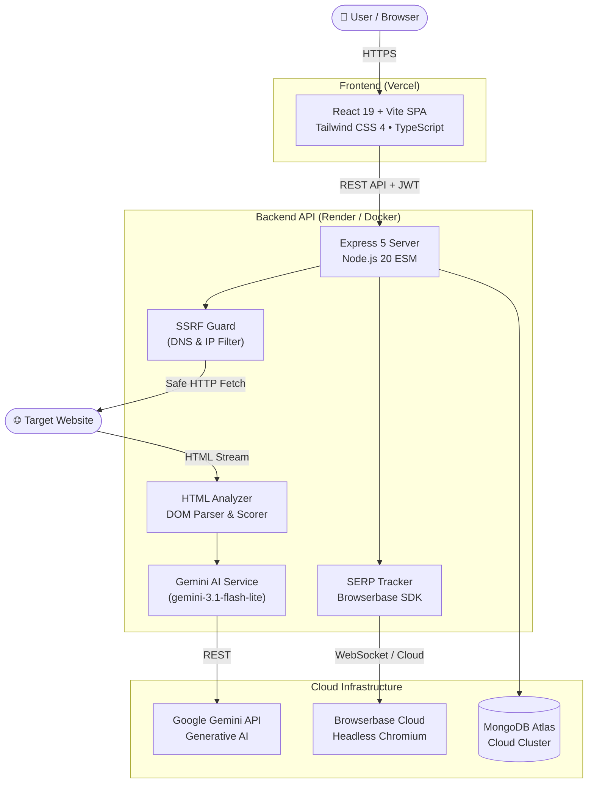

<div align="center">

# 🚀 Rank Pilot — AI SEO Tracker & SERP Analyzer

### *Next-Gen Technical SEO Audit Engine, Google Keyword Rank Tracker & Gemini-Powered AI Consultant*

[](https://ai-seo-tracker.vercel.app)
[](https://seo-tracker-backend-u651.onrender.com)
[](LICENSE)

<br/>

[](https://react.dev/)
[](https://www.typescriptlang.org/)
[](https://vitejs.dev/)
[](https://tailwindcss.com/)
[](https://nodejs.org/)
[](https://expressjs.com/)
[](https://www.mongodb.com/)
[](https://ai.google.dev/)
[](https://www.docker.com/)

<p align="center">
  <a href="#-key-features">Key Features</a> •
  <a href="#-system-architecture">Architecture</a> •
  <a href="#-live-demo--preview">Live Demo</a> •
  <a href="#-quick-start">Quick Start</a> •
  <a href="#-docker-deployment">Docker</a> •
  <a href="#-api-documentation">API Reference</a> •
  <a href="#-security-first-design">Security</a>
</p>

</div>

---

## 🌟 Overview

**Rank Pilot (AI SEO Tracker)** is an enterprise-grade full-stack SEO intelligence platform designed to replace costly third-party tools like Semrush and Ahrefs for modern web applications. 

It provides **sub-second technical on-page SEO audits**, tracks live **Google SERP positions up to 50 organic results deep**, and leverages **Google Gemini AI** to produce human-quality executive summaries, prioritized remediation roadmaps, and high-impact keyword opportunities.

---

## ✨ Key Features

### 🩺 1. Comprehensive Technical SEO Audit Engine
- **Full DOM Inspection:** Deep analysis of Title tags, Meta descriptions, Canonical links, Viewport settings, Charset, Open Graph (OG), and Twitter Cards.
- **Content & Structure Evaluation:** Heading hierarchy validator (`H1`–`H6`), body word count assessment, and top keyword extractor with density percentage.
- **Link & Media Health:** Internal vs. external link distribution mapping, plus missing image `alt` attribute detection.
- **Weighted Category Scoring (0–100):** Transparent scoring for:
  - 🟢 **SEO Quality** (Meta, tags, robots, canonical)
  - ⚡ **Performance** (Document payload weight & server response latency)
  - ♿ **Accessibility** (Alt text coverage, semantic tags, contrast)
  - 🛡️ **Best Practices** (HTTPS, viewport, modern web standards)

### 🤖 2. Gemini-Powered AI Insights & Strategic Recommendations
- **Executive AI SEO Summary:** 2–3 sentence executive diagnosis evaluating current health and core vulnerabilities.
- **Smart Remediation Roadmap:** 4 prioritized, actionable suggestions referencing real DOM metrics from the audit.
- **Keyword Opportunities:** Suggests high-intent long-tail search terms specific to the site's niche.
- **On-Demand Generation & Refresh:** Single-click AI insight generator on completed reports with multi-model failover (`gemini-3.1-flash-lite` ➡️ `gemini-3.5-flash`).

### 🎯 3. Automated Google SERP Rank Tracker
- **Deep Search Scrapes:** Automates real Google searches up to 5 pages deep (top 50 organic results) using headless browser technology (Playwright & Browserbase).
- **Competitor Tracking:** Automatically pinpoints target domain ranks and extracts the top 10 competing ranking domains.
- **Historical Position Tracking:** Stores position changes over time to monitor keyword gains and drops.

### 🛡️ 4. Enterprise-Grade SSRF Protection
- **Zero-Trust URL Fetching:** Validates DNS hostnames, bans private IPv4/IPv6 subnets, loopback (`127.0.0.1`), link-local, multicast, and carrier-grade NAT blocks.
- **Redirect Re-Validation:** Re-validates every redirect hop against SSRF filters to prevent DNS rebinding attacks.
- **Resource Constraints:** Enforces 15-second timeouts, 5 MB maximum payload limits, and strict content-type verification.

### 👥 5. Strict User Isolation & Quota Management
- **JWT & Bcrypt Security:** Secure authentication with encrypted credential storage.
- **Tenant Isolation:** Every analysis and tracked keyword is scoped strictly to `userId` — preventing cross-tenant access.
- **Fair-Use Quota Engine:** Configurable daily scan allocations (50 scans/day for Free Tier) with automatic midnight reset.

---

## 🏗️ System Architecture



---

## 💻 Tech Stack

| Domain | Technologies Used |
|---|---|
| **Frontend** | React 19, TypeScript, Vite 8, Tailwind CSS 4, React Router 7, Axios, Lucide Icons, React Hot Toast |
| **Backend** | Node.js 20 (ESM), Express 5, Mongoose 9, JWT (`jsonwebtoken`), Bcrypt |
| **Artificial Intelligence** | Google Gemini API (`gemini-3.1-flash-lite`, `gemini-3.5-flash`), Google GenAI |
| **Automation & Scraping** | Playwright Core, Browserbase Cloud SDK (`@browserbasehq/sdk`) |
| **DevOps & Containers** | Docker (Alpine Multi-Stage), Nginx 1.27, Docker Compose, Render, Vercel |
| **Testing** | Node.js Native Test Runner (`node --test`), 23/23 Automated Unit Tests |

---

## 🚀 Live Demo & Preview

* 🌐 **Production Frontend:** [https://ai-seo-tracker.vercel.app](https://ai-seo-tracker.vercel.app)
* ⚙️ **Production API:** [https://seo-tracker-backend-u651.onrender.com](https://seo-tracker-backend-u651.onrender.com)

---

## 📦 Project Directory Structure

```text
AI-SEO-Tracker/
├── client/                      # React 19 Frontend
│   ├── src/
│   │   ├── components/          # Reusable UI (ScoreGauge, IssueCard, AnalysesCard, Navbar)
│   │   ├── context/             # Global Auth, Theme & API Context
│   │   ├── pages/               # Dashboard, Analyze, Report, RankTracker, History, Auth
│   │   └── App.tsx              # Application Routes & Protected Wrappers
│   ├── Dockerfile               # Multi-stage production build (Node build -> Nginx serve)
│   ├── nginx.conf               # High-performance SPA routing + asset cache
│   └── vercel.json              # Vercel deployment configuration
├── server/                      # Express 5 Backend
│   ├── config/                  # MongoDB Atlas connection & index initialization
│   ├── controllers/             # Auth, Analysis, and Rank tracking controllers
│   ├── middleware/              # JWT verification middleware
│   ├── models/                  # Mongoose Schemas (User, Analysis, KeywordTracking)
│   ├── routes/                  # API endpoints (/api/auth, /api/analysis, /api/rank)
│   ├── services/                # SSRF Guard, HTML Analyzer, Gemini AI, SERP Scraper
│   ├── tests/                   # 23 unit tests (SSRF, Analyzer, Quota, Access Control)
│   └── Dockerfile               # Production Node.js Alpine container
├── docker-compose.yml           # Full-stack multi-container orchestrator
└── render.yaml                  # Render Infrastructure-as-Code Blueprint
```

---

## ⚡ Quick Start (Local Development)

### Prerequisites
* **Node.js** `20.19+` or `22.12+`
* **npm** `10+`
* **MongoDB** (local or MongoDB Atlas connection string)

### 1. Clone the Repository
```bash
git clone https://github.com/Adity-code2145/AI-SEO-Tracker.git
cd AI-SEO-Tracker
```

### 2. Configure Environment Variables

Create `server/.env`:
```dotenv
PORT=5000
MONGODB_URI=mongodb+srv://<username>:<password>@cluster.mongodb.net/seo-tracker
JWT_SECRET=your_super_secret_jwt_key
GEMINI_API_KEY=your_gemini_api_key
BROWSERBASE_API_KEY=your_browserbase_api_key
CLIENT_URL=http://localhost:5173
GOOGLE_SEARCH_COUNTRY=in
GOOGLE_SEARCH_LANGUAGE=en
```

Create `client/.env`:
```dotenv
VITE_BACKEND_URL=http://localhost:5000
```

### 3. Install Dependencies & Run

```bash
# Terminal 1: Backend
cd server
npm install
npm run server       # Runs with nodemon on port 5000

# Terminal 2: Frontend
cd client
npm install
npm run dev          # Runs on http://localhost:5173
```

---

## 🐳 Docker Deployment (1-Command Full Stack)

Spin up both the **Frontend (Nginx)** and **Backend (Node.js)** containers seamlessly:

```bash
# 1. Copy sample environment file
cp .env.example .env

# 2. Fill in your credentials in .env, then run:
docker compose up --build -d
```

- **Frontend Application:** `http://localhost:3000`
- **Backend API:** `http://localhost:5000`

To stop containers:
```bash
docker compose down
```

---

## 🧪 Testing & Code Quality

The test suite covers SSRF attack vectors, HTML parsing logic, quota controls, and data ownership:

```bash
# Run server test suite (23 tests)
cd server
npm test

# Run client linting & type checks
cd ../client
npm run lint
npm run build
```

```text
✔ getAnalysis rejects invalid ObjectId with 400
✔ getAnalysis queries strictly with authenticated userId
✔ deleteAnalysis enforces user ownership
✔ extractSeoData parses metadata, headings, links, and images
✔ computeSeoScoreAndIssues awards high score for compliant page
✔ isIpSafe correctly detects public vs private/loopback/link-local IPs
✔ validateHostSafe rejects hosts resolving to restricted IPs
✔ safeFetchHtml re-validates redirect destinations against SSRF
...
ℹ pass 23 / 23 (100% passing)
```

---

## 📡 API Reference

All protected routes require an `Authorization: Bearer <token>` header.

### 🔐 Authentication (`/api/auth`)
| Method | Endpoint | Description | Auth |
|---|---|---|---|
| `POST` | `/api/auth/register` | Register new user account | ❌ No |
| `POST` | `/api/auth/login` | Login user & return JWT token | ❌ No |
| `GET` | `/api/auth/user` | Fetch active user profile & daily quota | 🔒 Yes |

### 🔍 SEO Analysis (`/api/analysis`)
| Method | Endpoint | Description | Auth |
|---|---|---|---|
| `POST` | `/api/analysis` | Queue a website URL for technical audit | 🔒 Yes |
| `GET` | `/api/analysis` | List user audits (supports `?page=`, `?search=`, `?sort=`) | 🔒 Yes |
| `GET` | `/api/analysis/:id` | Get audit results & category scores | 🔒 Yes |
| `POST` | `/api/analysis/:id/ai-insights` | Generate/regenerate Gemini AI insights on demand | 🔒 Yes |
| `DELETE` | `/api/analysis/:id` | Delete an audit record | 🔒 Yes |

### 📈 SERP Rank Tracking (`/api/rank`)
| Method | Endpoint | Description | Auth |
|---|---|---|---|
| `POST` | `/api/rank/add` | Add `{ keyword, url }` to track Google rank | 🔒 Yes |
| `GET` | `/api/rank/list` | List all tracked keywords & latest ranks | 🔒 Yes |
| `GET` | `/api/rank/:id` | Get rank history, competitors & trends | 🔒 Yes |
| `POST` | `/api/rank/:id/refresh` | Trigger real-time Google search scrape | 🔒 Yes |
| `DELETE` | `/api/rank/:id` | Remove a tracked keyword | 🔒 Yes |

---

## 🔒 Security-First Design

1. **DNS Rebinding & SSRF Mitigation:** DNS resolution occurs prior to HTTP requests. Every resolved IP is checked against RFC 1918, RFC 3927, and RFC 6598 private blocks. All redirect hops are recursively validated.
2. **Denial of Service Prevention:** Streaming HTTP requests are bounded by `maxByteLength = 5MB` and abort signals (`timeout = 15s`).
3. **Cross-Tenant Isolation:** Database queries enforce `{ _id: recordId, userId: req.userId }` on all mutating and reading operations.
4. **Strict CORS Policy:** Whitelists allowed production origins only.

---

## 📄 License

This project is licensed under the **MIT License** — feel free to use, modify, and build upon this code for personal or commercial projects. See the [LICENSE](LICENSE) file for details.

---

<div align="center">
  <b>Built with ❤️ by <a href="https://github.com/Adity-code2145">Aditya Raj</a></b>
  <br/>
  <i>If you find this project helpful, please give it a ⭐ on GitHub!</i>
</div>
